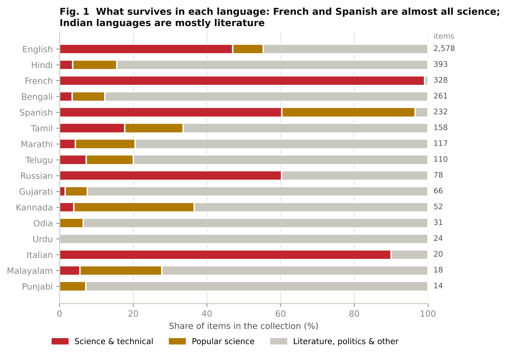
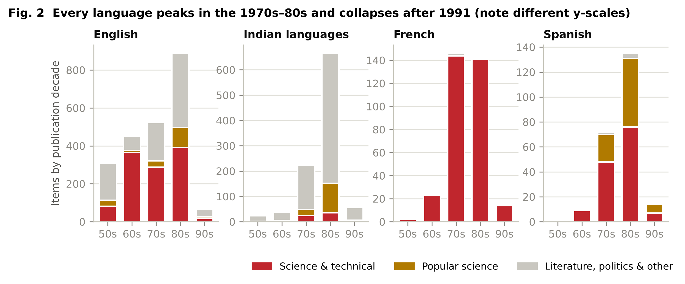
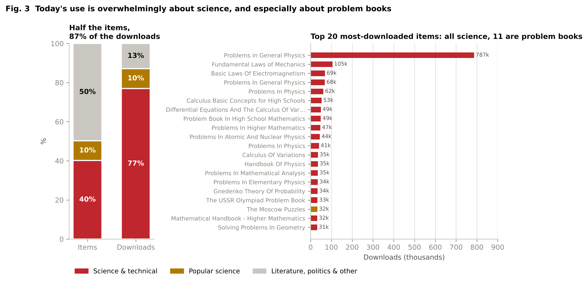
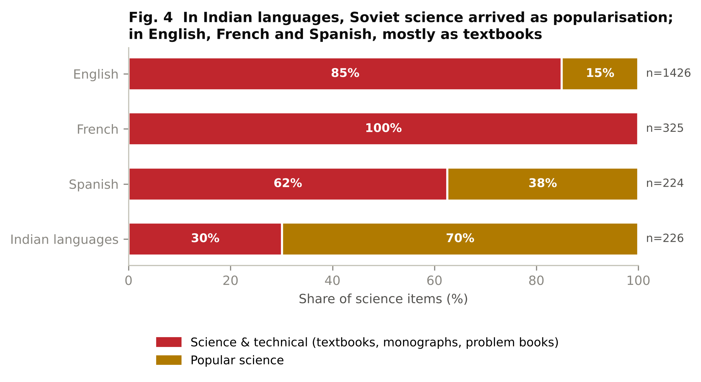
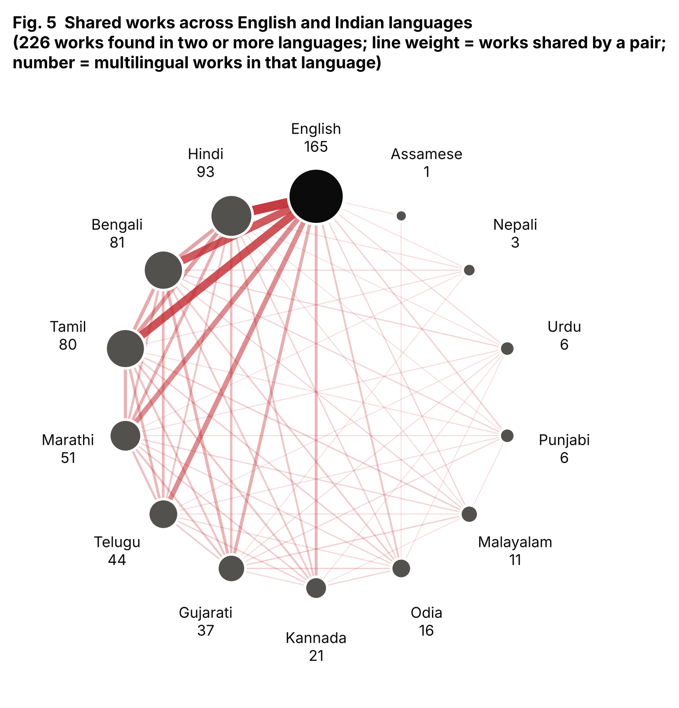
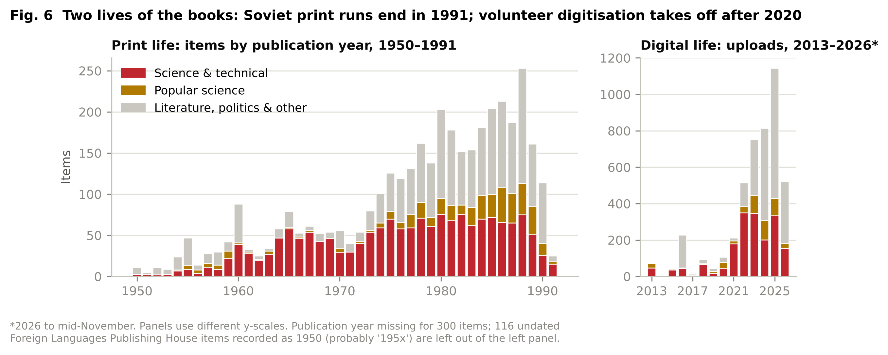
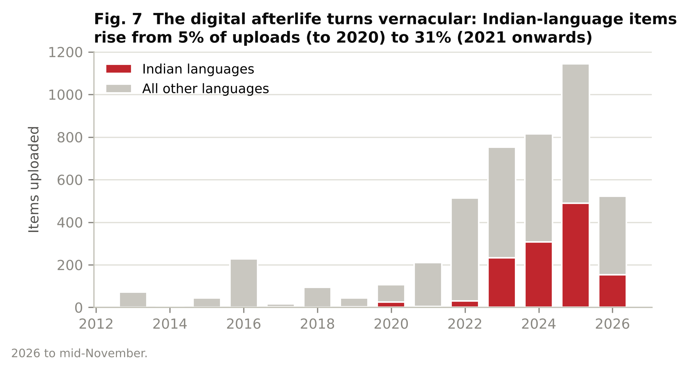

# 1. Introduction

Between the mid-1950s and 1991 the Soviet Union ran what may have been the largest state translation programme in history. Moscow publishing houses translated Russian and Soviet books into dozens of languages and shipped them abroad at very low prices. India was their largest market. A US intelligence assessment from 1985 estimated that the Soviet Information Department in New Delhi alone distributed some 25 million magazines, books and pamphlets a year in India (Central Intelligence Agency 1985). For several generations of Indian readers, Soviet books were part of growing up.

This history has attracted growing scholarly attention, mostly along two lines. The first treats the books as instruments of Cold War cultural diplomacy and asks how the Soviet state organised, funded and steered them (Gould-Davies 2003; Djagalov 2020; Bachman 2019). The second asks how readers received and now remember the books, with a strong emphasis on literature and children's books (Rajagopalan 2024; Maguire and McAteer 2024). Both lines have shown that Soviet books mattered in postcolonial India, and that their influence cannot be reduced to propaganda. Bachman's archival work, for example, shows that Indian readers' demand shaped what Moscow published, and that children's books, not Marxist classics, were the backbone of Soviet book exports (Bachman 2019).

Science books have a curious place in this literature. They were a large part of the programme: from 1963 a dedicated publisher, Mir, handled all scientific and engineering translation (Bachman 2019). They are also central to popular memory. Indian readers often credit Soviet physics and mathematics books with shaping their education or careers (Rajagopalan 2024, 207–208). Yet science books are seldom the main object of study. They usually appear as one category among several.

This paper takes a different route into the topic. Instead of the archives of production or interviews about reception, it studies the books' *afterlife*: the volunteer-built digital collection through which many of them now circulate. The Mir Titles collection on the Internet Archive holds 4,566 digitised Soviet books in 25 languages, uploaded between 2013 and 2026. Its metadata (titles, languages, publishers, dates, subjects, translator credits and download counts) can be analysed at scale, using the methods of distant reading and cultural analytics (Moretti 2005; Manovich 2020).

The paper asks three questions:

1. What does the collection contain, and how does its composition differ by language?
2. Which books are used today, as measured by downloads?
3. What does the collection suggest about how Soviet science reached Indian readers, and how is that changing in the digital afterlife?

The argument, in brief, is that the afterlife of Soviet books is organised around science learning, and specifically around problem-solving. Books exported as instruments of state influence have been turned, by volunteers, into an informal open educational commons. In India, the collection also points to two distinct channels through which Soviet science arrived: textbooks in English and popularisation in Indian languages.

# 2. Background: Soviet foreign-language publishing and India

The Foreign Languages Publishing House (FLPH) in Moscow was the main Soviet publisher for foreign readers in the 1950s. In 1963 it was split in two: Progress took non-scientific titles (literature, children's books, social and political works), and Mir took all scientific and engineering translation. In 1982 Progress's literature and children's departments became a new house, Raduga (Bachman 2019; Strelkova 2024). By 1981 Progress alone was releasing 1,400 titles a year in 50 foreign languages, with a combined print run of 25 million copies (Bachman 2019).

India occupied a special place in this system. Bachman's research in Soviet archives shows that by the late 1960s India was the largest consumer of Progress publications outside the socialist bloc, and that South and South-East Asian markets accounted for three-quarters of Progress's English-language sales in the 1950s and 1960s (Bachman 2019). A 1957 plan for the FLPH proposed 62 titles in Hindi, 39 in Bengali and 34 in Urdu, nearly 2.9 million copies in total, including books about Soviet "economic and scientific successes" (Brouillette 2015, cited in Rajagopalan 2024, 200). Indian translators were recruited to live and work in Moscow, translating into Indian languages (Rajagopalan 2024, 200; Ponomareva 2024).

Distribution in India ran through Soviet agencies and Indian partners. The CIA's 1985 assessment, a hostile source that must be read critically, describes two main channels: the Soviet Information Department, and the state book-export agency, V/O Mezhdunarodnaya Kniga, which organised book fairs and sold "at cut-rate prices through USSR Bookstores and Indian bookstalls" (Central Intelligence Agency 1985, 15). It also reports that Soviet books were sold to People's Publishing House (PPH), owned by the Communist Party of India, at a 60–65% discount, and that these supplies made up three-quarters of PPH's sales (Central Intelligence Agency 1985). Readers remember a looser landscape as well: dedicated stores, book fairs, pavement stalls and travelling salesmen (Rajagopalan 2024, 200–201).

What Indian readers bought is also clearer now. Bachman finds that Progress sold more copies of children's titles than of any other genre between 1953 and 1973, and that by the late 1960s children's books outnumbered Marxist-Leninist classics in exports by eight to one (Bachman 2019). Popular science sat at the boundary between these categories: Progress and later Raduga published illustrated science books for children, while Mir published popular series such as *Science for Everyone*, *Physics for Everyone* and the *Little Mathematics Library* alongside university textbooks.

The economic and political rationale of the programme ended in 1991. Soviet foreign-language publishing collapsed, and copies became scarce. Since the 2010s, however, enthusiasts have been scanning and sharing these books online. The most systematic effort is the Mir Titles project, which describes itself as a collection of "books from the Soviet era" and has uploaded thousands of scans to the Internet Archive (Mir Titles n.d.). This digital afterlife is the object of the present study.

# 3. Data and methods

## 3.1 The corpus

The data are the metadata of every item in the Internet Archive collection `mir-titles`, retrieved on 15 November 2026 through the Archive's public search and metadata APIs. The collection contained 4,566 items. For each item I collected the catalogue record (title, creator, date, language, subject tags, publisher, description), the Archive's own derived fields (upload date, uploader, language and script detected by optical character recognition), the cumulative download count, and a cover thumbnail.

The collection is the work of one curatorial project: 98.2% of items were uploaded by a single account (mirtitles). It is therefore not a random sample of Soviet publishing. It is a record of what one volunteer community has found, scanned, received from others and chosen to share. This matters for interpretation, as section 6 discusses.

All code and derived data are openly available (see the data availability statement). Every number below is produced by the scripts in the repository.

## 3.2 Cleaning

**Language.** Language was assigned in order of reliability: first from explicit markers in the title (Indian-language items usually carry an English gloss such as "(All About The Telescope In Tamil)"), then from the catalogue's language field, then from the Archive's OCR-based language detection. This left 62 items (1.4%) with no identifiable language. Indian languages were grouped together for some analyses.

**Publisher.** Publisher strings in several scripts and spellings (for example "Editorial Mir", "Éditions Mir", and "Mir Prakashan" in Devanagari) were normalised to Mir, Progress, Raduga, FLPH and a small number of other categories. 1,235 items (27%) have no publisher recorded.

**Date.** 4,266 items (93%) have a publication year. 116 undated FLPH items are recorded as 1950, probably standing in for "195x"; they are kept in decade counts but excluded from year-by-year charts.

**Translators and scanners.** Item descriptions often record the translator ("Translated from the Russian by…") and sometimes credit the person who supplied the scan ("Many thanks to … for the original scan"). Both were extracted with regular expressions.

## 3.3 Classification

Each item was assigned to one of five domains using ordered rules over its subject tags, title, series and publisher:

- **Popular science**: popular-science tags in several languages, named popular series (*Science for Everyone*, *Little Mathematics Library*, *Physics for Everyone*, *Lecciones Populares de Matemáticas* and others), and phrases such as "for entertainment" or "can be fun";
- **Science and technical**: textbooks, monographs, handbooks, problem books, engineering and medicine, identified by multilingual subject keywords, or by Mir as publisher where no literary tag is present;
- **Literature**: fiction, children's fiction, folk tales, poetry and drama, including science fiction;
- **Politics and society**: Marxism-Leninism, philosophy, history, economics and education theory;
- **Other**: unmatched items, mostly literature without subject tags.

The collection's near-universal tag "Soviet literature" (and its equivalents in Indian languages) was ignored, since it is applied to science and literature alike.

For most analyses the first two domains are combined as "science" and the rest as "non-science". A random check of 80 items (50 classed as science, 30 as non-science) found 47 of 50 and 30 of 30 correct: an estimated accuracy of about 94% for the science class. The main error is science fiction novels classed as science. A formal validation on a stratified sample of 200 items is in progress, and its results will be reported in the next version of this paper. The headline findings below rest on large differences (for example 70% against 15%) that misclassification at this rate cannot plausibly reverse.

## 3.4 Measures

**Downloads** are the Internet Archive's cumulative download counts at the time of retrieval. Because items uploaded earlier have had longer to accumulate downloads, I also report downloads per year online. Concentration is summarised with the Gini coefficient and with the shares of downloads going to the top 1% and 10% of items. **Problem books** are identified by title keywords (problem, problems, exercises, olympiad, solving and equivalents).

**Cross-language matching.** For the network analysis, an Indian-language item and an English item are treated as the same work when the English gloss in the Indian-language title, once normalised, matches the English title. This finds only works with an English gloss, so it understates links, and it cannot match French or Spanish titles.

# 4. Results

## 4.1 What the collection contains

The collection holds 4,566 items in 25 languages. English dominates (2,578 items), followed by Hindi (393), French (328), Bengali (261), Spanish (232), Tamil (158), Marathi (117) and Telugu (110). Thirteen Indian languages together account for 1,250 items. Most dated items (3,906) were published between 1950 and 1991. Mir is the most common identified publisher (1,231 items), followed by Progress (757), Raduga (546) and the FLPH (351). The collection also contains 112 English translations of Soviet scientific work produced in the West, for example by NASA and the Israel Program for Scientific Translations.

Science is half the collection: 1,835 items are classed as science and technical and 458 as popular science (together 50.2%), against 1,817 literature, 252 politics and society, and 204 other.

The composition differs sharply by language (Figure 1). The French holdings are 99% science and the Spanish 97%. English is 55%. Indian-language holdings are only 18% science (226 of 1,250 items). Literature and children's books make up most of the Hindi, Bengali, Gujarati, Odia and Urdu holdings. Tamil (34%) and Kannada (37%) have the highest science shares among Indian languages.

These differences partly mirror the publishers' division of labour: French and Spanish holdings come overwhelmingly from Mir's French and Spanish lines (*Éditions Mir*, *Editorial Mir*), while Indian-language holdings come largely from Progress and Raduga. They also reflect what volunteers have chosen to scan. The two cannot be separated with these data alone (section 6).

Across all language groups, holdings peak in the 1970s and 1980s and collapse after 1991 (Figure 2). Indian-language holdings are concentrated in the 1980s: 665 of the 1,178 dated Indian-language items are from that decade. This is consistent with the expansion of Indian-language publishing in Moscow in the last Soviet decade that readers remember (Rajagopalan 2024, 207).

## 4.2 What is used: science and problem books

The 4,566 items had been downloaded 9,191,358 times by November 2026. Use is highly unequal: the Gini coefficient of downloads is 0.75, the top 1% of items (45 titles) account for 25% of downloads, and the top 10% for 64%.

The clearest pattern is the dominance of science (Figure 3). Science items are 50% of the collection but receive 87% of downloads. The median science item has been downloaded 1,293 times; the median non-science item 260 times. Allowing for time online, the median technical science item receives 371 downloads a year, popular science 200, politics and society 123, and literature 84.

All 20 of the most downloaded items are science. Most are not popular science but the working tools of science education: problem books, handbooks and textbooks in physics and mathematics. The single most downloaded item is I. E. Irodov's *Problems in General Physics* (Mir, 1988 edition), with about 787,000 downloads, more than seven times the next title. In India this book is widely associated with preparation for engineering entrance examinations. Problem books as a group make up 4.9% of items but 25.1% of all downloads, and 11 of the top 20 titles.

Among science items, the median downloads per year online are similar for English (402), French (391) and Spanish (344), and much lower for Indian languages (93). Indian-language science items are used, but they are not the core of today's demand. The core is problem-solving material in world languages.

## 4.3 Two channels: textbooks in English, popularisation in Indian languages

Within science, the balance between technical and popular titles varies sharply by language (Figure 4). Among English science items, 85% are technical and 15% popular. Among French science items, almost all are technical. Spanish holdings are 62% technical and 38% popular, the latter largely from Mir's *Lecciones Populares de Matemáticas* and related series. In Indian languages the balance is reversed: 70% of science items are popular science, and only 30% technical.

The 226 Indian-language science items span twelve languages, led by Hindi (61), Tamil (53), Bengali (32), Marathi (24), Telugu (22) and Kannada (19). Of those with a date, 69% were published in the 1980s. They include volumes of Landau and Kitaigorodsky's *Physics for Everyone* in Hindi and Bengali, Il'in and Segal's *How Man Became a Giant*, *From the Bonfire to the Reactor*, and Klushantsev's *All About the Telescope* in Bengali, Gujarati, Hindi, Marathi and Tamil. Mir published about half of them (110); Progress and Raduga, the literature and children's houses, published 88. Soviet science in Indian languages thus travelled substantially through children's publishing.

This suggests two distinct channels through which Soviet science reached Indian readers. The English-language channel delivered university and pre-university textbooks and problem books: the material that now dominates downloads. The Indian-language channel delivered popularisation, often illustrated, often aimed at children, and frequently published by the same houses that produced Soviet children's literature. Rajagopalan's interviews capture this second channel exactly: a reader in Chennai recalls his grandmother reading *All About the Telescope* to him in Tamil every day, and attributes his later career in science to such books (Rajagopalan 2024, 207–208).

## 4.4 The same books in many languages

Cross-language matching finds at least 226 works that exist in the collection in English and one or more Indian languages, or in two or more Indian languages (Figure 5). On average such a work appears in 2.7 languages. The most widely shared include *The Ruffled Sparrow* (8 languages), *How Man Became a Giant* (7), *All About the Telescope* (6) and Perelman's *Physics for Entertainment* (5). About a third (35%) of the multilingual works are science.

The network has a clear hub-and-spoke structure. English shares the most works with Hindi (65), Tamil (55), Bengali (53), Marathi (33) and Telugu (32). Links among Indian languages are weaker but substantial (Hindi–Tamil 26, Bengali–Hindi 23, Bengali–Tamil 21). This is consistent with a programme that chose a common list of titles and translated it into many Indian languages, but it may also reflect which editions collectors hold.

## 4.5 Two lives: print and digital

Figure 6 sets the two lives of the collection side by side. The print life rises from the 1960s, peaks in the 1980s and ends abruptly in 1991. The digital life begins in 2013 and accelerates sharply after 2020: uploads grew from fewer than 250 a year before 2021 to 514 in 2022, 752 in 2023, 814 in 2024 and 1,143 in 2025.

The composition of the digital afterlife is changing too (Figure 7). Up to 2020, Indian-language items made up 4.8% of uploads; from 2021 onwards they made up 30.9%. The early digital collection was largely English science, the material most in demand. The more recent collection increasingly recovers Indian-language books, especially literature and children's books. Volunteer scanners are credited by name on 156 items; the four most credited (Guptaji, Anil Battula, Srujanika Publications and Daniel Baker) account for most of these, and three of the four work mainly or entirely on Indian-language books.

The translators recorded in the metadata form a different community from the scanners. 1,287 items name at least one translator, 575 distinct people in all. Among the most frequent, George Yankovsky, Leonid Levant, G. Leib and Nicholas Weinstein translated almost exclusively science, while Margaret Wettlin, Olga Shartse and Fainna Glagoleva translated literature. The metadata thus record two generations of intermediaries: the Moscow translators of the print era and the volunteer scanners of the digital era.

# 5. Discussion

## 5.1 From soft power to a learning commons

The historiography rightly treats Soviet foreign-language publishing as cultural diplomacy. But the afterlife studied here is organised around something else. What people download today is not, in the main, the political literature the programme was designed to spread, nor even the literature and children's books that readers remember most fondly. It is science, and above all the problem books and textbooks of physics and mathematics. Problem books, about one item in twenty, receive a quarter of all downloads.

One way to read this is that the books have been reconstituted as an informal open educational commons. The Soviet state made them cheap; their publishers' disappearance has left their rights in practical limbo; volunteers have digitised them; and learners, many of them presumably preparing for examinations, use them. In this, the Mir afterlife resembles the "shadow libraries" through which students in many parts of the Global South obtain textbooks outside formal markets (Karaganis 2018), but with a difference: much of its content was produced by a state for export at a nominal price and was always meant to circulate widely.

This reading has limits. Download counts cannot tell us who the users are or where they are. And the Internet Archive is only one route: other copies circulate on other sites and in print reprints. But the size of the gap between science and non-science (87% of downloads from half the items) is large enough to be robust to these caveats.

## 5.2 Popularisation as a vernacular project

The second finding concerns the history of science popularisation in India. In the surviving collection, Soviet science in English is mostly technical, while Soviet science in Indian languages is mostly popular. If this pattern reflects what was originally published, and not only what has been preserved, it implies that the Soviet programme's contribution to science popularisation in India was disproportionately a vernacular one, carried by illustrated books for children and general readers, and often by the children's publishers Progress and Raduga rather than by Mir.

This connects the Mir story to a wider history of science communication in Indian languages, including the people's science movements of the 1960s–1980s, such as the Kerala Sastra Sahitya Parishad, which also worked to bring science to readers in their own languages. Whether Soviet books were used or adapted by such movements is a question the present data cannot answer, but it is a promising one for archival and oral-history research.

## 5.3 The vernacular turn in the digital afterlife

The third finding is that the digital afterlife is shifting from English science towards Indian-language books. The first wave of digitisation served existing demand; the second appears to be driven by recovery and nostalgia: volunteers seeking out the Hindi, Tamil, Bengali or Telugu books of their childhood. This mirrors the memory culture described by Rajagopalan (2024), in which Soviet books function as objects of personal and family memory. It also means that the collection is slowly becoming a more complete record of the Indian-language programme, which until recently had been the least preserved part of it.

## 5.4 What a digital collection can and cannot tell us

The study shows both the promise and the limits of using a volunteer digital collection as a historical source. It allows questions of scale (thousands of books, dozens of languages, millions of downloads) that archival and interview methods cannot easily address. But its composition is the product of collecting, not publishing. Distant reading of such a collection is, in effect, a study of the afterlife first and of the original programme only by inference.

# 6. Limitations

1. **Survival and curation bias.** The collection records what was kept, scanned and shared, mostly by one project. Differences between languages (for example the low science share in Indian languages) may reflect volunteers' interests rather than original publishing. A publication baseline (publishers' annual catalogues, library holdings or Soviet book-chamber statistics) is needed to separate the two. None of Mir's catalogues was found online.
2. **Downloads.** Counts are cumulative, global and specific to the Internet Archive. They do not reveal where users are, and they favour earlier uploads; per-year medians only partly correct for this.
3. **Classification.** Domains were assigned by rules. A spot-check suggests about 94% accuracy for science; a formal 200-item validation is in progress. Science fiction and children's nature books are the most ambiguous categories.
4. **Missing metadata.** 27% of items lack a publisher, 7% a date and 1.4% a language. 116 FLPH items carry a placeholder year.
5. **Matching.** Cross-language matching relies on English glosses and therefore understates links, especially for French and Spanish, which it cannot match at all.
6. **Sources on distribution.** The figures on Soviet distribution in India come partly from a CIA assessment written for Cold War purposes and should be treated as indicative, not authoritative.

# 7. Conclusion

The Soviet Union exported books to the Global South as instruments of influence. In their digital afterlife, at least as recorded in the largest volunteer collection, these books are used overwhelmingly for learning science, and especially for practising it through problem books. In India, the collection suggests that Soviet science arrived through two channels: technical books in English and popular science in Indian languages, the latter often through children's publishers. And the digital afterlife is itself changing, as volunteers recover the Indian-language books of their childhood.

These findings point to further work: a publication baseline to test survival bias, a formal validation of the classification, a comparison of cover design across languages, oral histories with readers, scanners and translators, and archival research on whether Soviet popular science was taken up by India's people's science movements. They also suggest that the history of Cold War cultural diplomacy has an epilogue that is still being written, by volunteers and learners, on the open web.

# Data and code availability

The derived data (cleaned and classified metadata for all 4,566 items), analysis scripts and figures are held in the repository <https://github.com/sumeghp/mir-titles-analysis> (currently private; to be made public with a later version of this paper). Source metadata are from the Internet Archive collection <https://archive.org/details/mir-titles>, retrieved 15 November 2026.

# Acknowledgements

I thank the Mir Titles project and the volunteers who have scanned and shared these books.

# References

Bachman, Jessica. 2019. *Books Across Borders: Cold War Culture, Soft Power, and the Production of Soviet Books for Postcolonial India, 1954–1991*. Title VIII Research Scholar Program final report. Washington, DC: American Councils for International Education. <https://www.researchabroad.americancouncils.org/s/Final-Report-edited-for-web_Bachman.pdf>

Brouillette, Sarah. 2015. "US–Soviet Antagonism and the 'Indirect Propaganda' of Book Schemes in India in the 1950s." *University of Toronto Quarterly* 84 (4): 170–188.

Central Intelligence Agency, Directorate of Intelligence. 1985. *The Soviets in India: Moscow's Major Penetration Program*. Intelligence Assessment GI 85-10315, December 1985. CIA-RDP86T00586R000400490007-7. Declassified 2011.

Djagalov, Rossen. 2020. *From Internationalism to Postcolonialism: Literature and Cinema between the Second and the Third Worlds*. Montreal: McGill-Queen's University Press.

Gould-Davies, Nigel. 2003. "The Logic of Soviet Cultural Diplomacy." *Diplomatic History* 27 (2): 193–214.

Karaganis, Joe, ed. 2018. *Shadow Libraries: Access to Knowledge in Global Higher Education*. Cambridge, MA: MIT Press.

Maguire, Muireann, and Cathy McAteer, eds. 2024. *Translating Russian Literature in the Global Context*. Cambridge: Open Book Publishers. <https://doi.org/10.11647/OBP.0340>

Manovich, Lev. 2020. *Cultural Analytics*. Cambridge, MA: MIT Press.

Mir Titles. n.d. *Mir Books: Books from the Soviet Era*. <https://mirtitles.org>; Internet Archive collection <https://archive.org/details/mir-titles>.

Moretti, Franco. 2005. *Graphs, Maps, Trees: Abstract Models for a Literary History*. London: Verso.

Ponomareva, Anna. 2024. "The Visibility of the Translator: A Case Study of the Telugu Section in Progress Publishers and Raduga." In Maguire and McAteer 2024, 429–436. <https://doi.org/10.11647/OBP.0340.26>

Rajagopalan, Sudha. 2024. "Soviet Books, Geopolitical Imagination, and Eclectic Solidarities in India." In *Performing the Cold War in the Postcolonial World: Theatre, Film, Literature and Things*, edited by Christopher B. Balme, 197–222. London: Routledge. <https://doi.org/10.4324/9781003196334-14>

Strelkova, Guzel'. 2024. "The Translation of Russian Literature into Hindi." In Maguire and McAteer 2024. <https://doi.org/10.11647/OBP.0340.25>

Suhail, Ayesha. 2024. "Tolstoy in India: Translating Aspirations across Continents." In Maguire and McAteer 2024. <https://doi.org/10.11647/OBP.0340.27>
